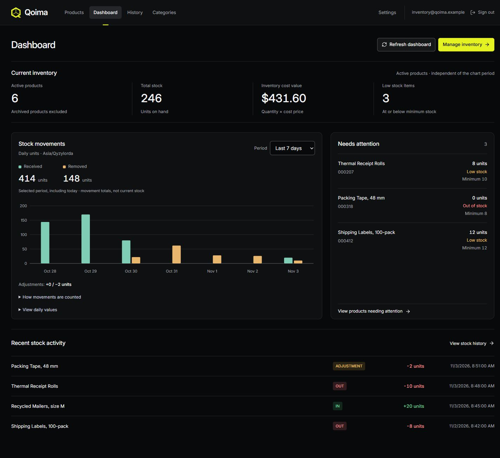
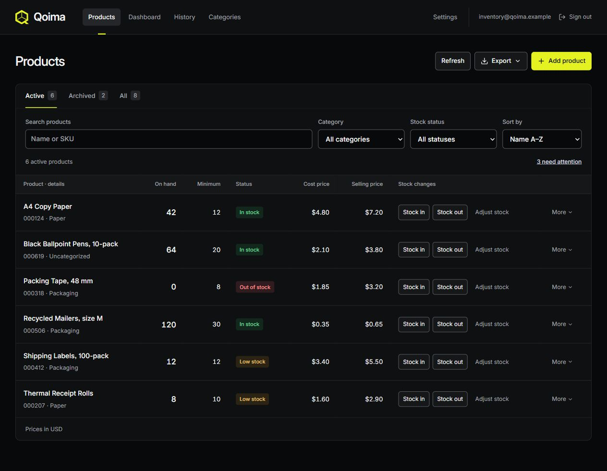
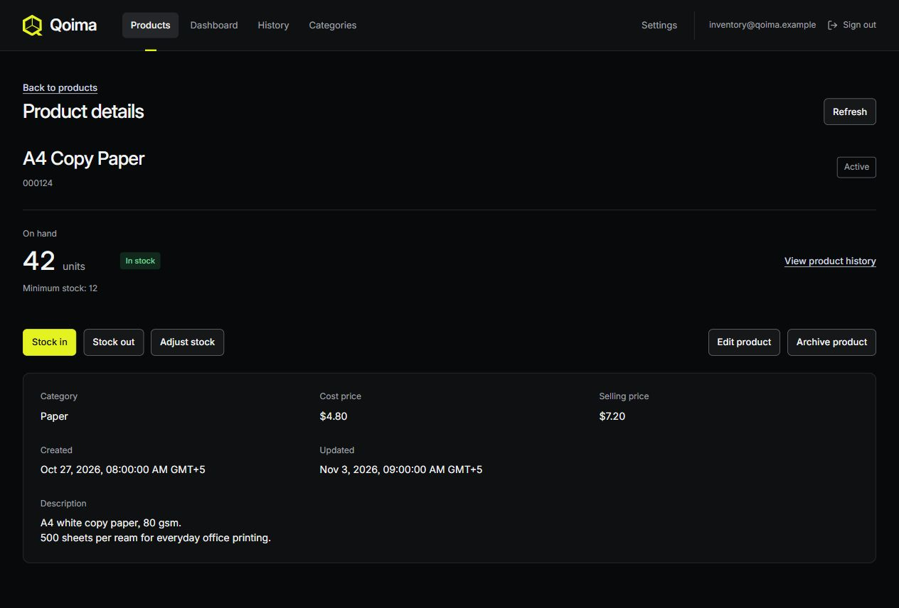
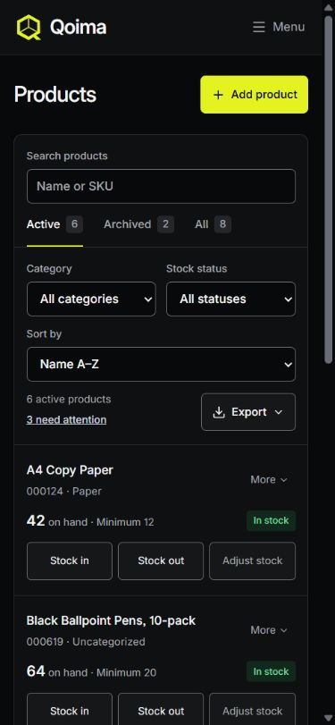

# Qoima — Digital Warehouse

**Inventory management for small businesses.** Organize products, receive and remove stock, reconcile counted quantities, and keep a clear movement history.

**[Open Live Demo →](https://qoima-nine.vercel.app)** · [GitHub](https://github.com/mrreikol/Qoima) · [Development guide](docs/development.md)

Inventory pages require sign-in. Each account manages its own products and stock history.



*Screenshots show the actual current interface with illustrative fictional inventory, captured in an isolated, read-only local fixture. They contain no live account or business data.*

## A closer look

| Products | Product details | Mobile |
| --- | --- | --- |
| <a href="docs/screenshots/products-desktop.jpg"></a> | <a href="docs/screenshots/product-details-desktop.jpg"></a> | <a href="docs/screenshots/products-mobile.jpg"></a> |

Select a screenshot to view it at full size. [Capture details](docs/screenshots/README.md).

## What it does

- **Inventory workspace:** products, categories, SKU/name search, filters, sorting, detail views and archival. Deleting a category preserves products and history, with an explicit reassignment choice.
- **Stock operations:** separate Stock in, Stock out and Actual quantity adjustment actions. Metadata editing never changes stock; archived products retain their history.
- **Dashboard:** active-product totals, inventory cost value, low/out-of-stock warnings and 7/30-day stock movement charts.
- **History:** server-side pagination, full product-name/SKU search, product/type/date filters and archived-product visibility, using local calendar-day boundaries.
- **CSV and Excel:** all products matching the current filters and sorting, including leading-zero SKUs, Unicode and safe literal text. Excel generation loads only when requested.
- **Accounts and appearance:** email confirmation, persistent sessions, password recovery and protected routes; browser-local Light / Dark / System controls in Settings.

## Technology and engineering

React · JavaScript · Vite · Tailwind CSS · React Router · Lucide React · Supabase Auth/PostgreSQL. ExcelJS handles XLSX; Node's test runner and PGlite cover local verification.

Stock changes use row locks and atomic database RPCs. Client-generated operation UUIDs make identical retries idempotent; uncertain responses preserve the original request for recovery. RLS, restricted grants and ownership constraints isolate users and prevent cross-account category assignment. [Transaction and isolation details](docs/development.md#transactions-and-user-isolation).

## Run locally

Use Node.js 22.21.1 or newer supported LTS and npm. From a fresh checkout:

```powershell
npm ci
Copy-Item .env.example .env.local
```

Set `VITE_SUPABASE_URL` and `VITE_SUPABASE_PUBLISHABLE_KEY` in `.env.local`, using the project URL and browser-safe publishable key. Never use a secret/service-role key. Do not overwrite an existing local configuration.

Apply only pending migrations, once, in order:

1. [Inventory foundation](supabase/migrations/20261102180000_inventory_foundation.sql)
2. [Stock operations](supabase/migrations/20261103090000_stock_operations.sql)
3. [Category deletion](supabase/migrations/20261103193000_category_deletion.sql)

Configure Supabase email authentication and the local `/dashboard` and `/reset-password` redirect URLs as described in the [setup guide](docs/development.md#local-setup), then run:

```powershell
npm run dev
```

Missing configuration shows setup instructions; the production app has no demo-authentication or sample-inventory fallback.

## Verify

```powershell
npm run build
node scripts/report-build.mjs after
npm test
npm run lint
npm run check:release-files
```

Regenerate the build report after source/build changes; it supplies the chunk-graph regression test. Tests use isolated local fixtures and do not mutate remote Supabase. See the [release checklist](docs/release-checklist.md) for actual completed checks and remaining verification, and the [development guide](docs/development.md#checks) for audit, staged-file and preview commands.

## Deployment and current limitations

[Vercel configuration and deployment steps](docs/development.md#vercel-deployment) cover environment variables, SPA routing and Supabase redirects. The live-demo link above is provided by the project owner; it does not imply every hosted verification item is complete.

- Inventory is account-owned; shared workspaces, staff roles and archived-product restoration are not implemented.
- The lazy XLSX chunk still triggers Vite's size warning. Thresholds have not been raised.
- The [dated dependency review](docs/dependency-review.md) records a remaining minimatch advisory. Re-run audits for current results; no security certification is claimed.
- Real multi-page History, uncertain-response UI recovery and authenticated production/mobile checks remain on the release checklist. Local PGlite tests do not prove independent-session concurrency.

The bundled [Inter font license](src/assets/fonts/Inter-OFL.txt) is preserved. A project-wide open-source license has not been selected.
